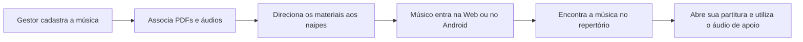

  

# Forte Piano

**Seu repertório na sua mão.**

Aplicação Web e Android para organizar o repertório de uma orquestra e distribuir partituras e áudios conforme o perfil e os naipes de cada pessoa.

Desenvolvido como Trabalho de Conclusão de Curso, o Forte Piano conecta a manutenção do acervo à experiência de quem precisa encontrar e consultar seu material durante estudos e ensaios.

> **Estado do projeto · novembro de 2026:** primeira versão implementada. Publicação em produção e testes em cenários reais são as próximas etapas.

Este repositório apresenta o produto, suas funcionalidades e decisões técnicas. O código-fonte é mantido em repositório privado.

## Conheça o projeto

- [O problema e a proposta](#o-problema-e-a-proposta)
- [Funcionalidades](#funcionalidades)
- [Perfis de acesso](#perfis-de-acesso)
- [Como funciona](#como-funciona)
- [Tecnologias](#tecnologias)
- [Decisões técnicas](#decisões-técnicas)
- [Estado da entrega](#estado-da-entrega)
- [Funcionalidades em detalhe](docs/funcionalidades.md)
- [Arquitetura e fluxos](docs/arquitetura.md)

## O problema e a proposta

Uma música pode ter diferentes partituras, partes por instrumento e áudios de apoio. Distribuir esses materiais exige manter a relação entre o repertório, os naipes e as pessoas que precisam de cada parte.

O Forte Piano organiza essas informações em um mesmo sistema. Maestro e Arquivista mantêm o conteúdo; o Músico encontra as músicas disponíveis e acessa os materiais correspondentes aos seus naipes.

A proposta é facilitar a preparação musical com uma interface de consulta direta e ferramentas de leitura de PDF e reprodução de áudio. A avaliação dos benefícios no ensaio fará parte dos testes com usuários reais.

## Funcionalidades

| Área | Recursos implementados |
|---|---|
| Acesso | Login, restauração de sessão, primeiro acesso e recuperação de senha por código de e-mail |
| Repertório | Pesquisa de músicas, categorias, detalhes, observações e estado ativo/inativo |
| Partituras | Leitura de PDFs enviados ao sistema ou vinculados a um acervo do Google Drive |
| Leitor Android | Navegação por páginas, zoom por pinça até 3×, arraste, ajuste à tela e adaptação à rotação |
| Áudio | Reprodução de arquivos enviados, pausa, seleção de faixa e controle de posição |
| Estudo no Android | Player recolhível no leitor para consultar a partitura com áudio de apoio |
| Acervo | Cadastro e edição de músicas, envio de PDFs/áudios e remoção de materiais |
| Pessoas | Convites, busca paginada e gestão de papéis, status e vínculos com naipes |
| Conta | Consulta do próprio perfil e alteração do nome |

As interfaces Web e Android compartilham a API e parte da lógica de integração. Cada uma mantém seus componentes e recursos próprios de navegação, arquivos e leitura.

Veja os [fluxos e limites por funcionalidade](docs/funcionalidades.md).

## Perfis de acesso

| Perfil | Responsabilidade |
|---|---|
| **Músico** | Consultar o repertório ativo e estudar com os materiais permitidos para seus naipes |
| **Arquivista** | Manter músicas e materiais do acervo, incluindo conteúdo inativo |
| **Maestro** | Gerenciar o conteúdo e administrar pessoas, papéis, status e vínculos com naipes |

Uma pessoa pode pertencer a mais de um naipe. A autorização é verificada no backend; a interface reflete as permissões da conta. Áudios sem naipe podem ser disponibilizados como material comum, enquanto partituras são direcionadas conforme os vínculos.

## Como funciona

O cadastro de pessoas é conduzido pelo Maestro. No primeiro acesso, a pessoa valida um código recebido por e-mail e escolhe sua senha. A consulta do repertório depende de uma conta ativa e autorizada.

## Tecnologias

| Camada | Tecnologias |
|---|---|
| Backend | C#, .NET 10, ASP.NET Core Web API |
| Persistência | Entity Framework Core, Npgsql e PostgreSQL |
| Identidade | Supabase Auth e autenticação JWT |
| Arquivos | Supabase Storage e Google Drive API para PDFs |
| Web | React 19, Vite, React Router, TanStack Query e React PDF |
| Android | React Native, Expo, React Navigation, SecureStore, react-native-pdf e expo-audio |
| Lógica compartilhada | JavaScript, cliente HTTP, operações de API, consultas e fluxo de senha |
| Verificação técnica | Node Test Runner, ESLint, build Web e exportação do bundle Android |

## Decisões técnicas

**Uma API para os dois clientes.** As regras de negócio, permissões e dados ficam centralizados no backend. A experiência de interface é adaptada a navegador e dispositivo móvel.

**Backend em camadas.** Domain, Application, Infrastructure e API separam o modelo, os casos de uso, a persistência e a exposição HTTP. A organização é inspirada em Clean Architecture e proporcional ao tamanho do projeto.

**Reuso sem impor a mesma interface.** Os clientes compartilham integrações HTTP, consultas, utilitários e o fluxo de senha. Componentes de tela, navegação, armazenamento de sessão e leitores permanecem específicos de cada plataforma.

**Distribuição por naipe.** Os vínculos fazem parte do modelo de acesso. A seleção de materiais é aplicada no servidor, além dos controles apresentados na interface.

**PDF e áudio no fluxo de estudo.** O Android usa módulos nativos de leitura e reprodução, com navegação por toque e player recolhível no leitor. Os arquivos originais de PDF são preservados.

A [visão de arquitetura](docs/arquitetura.md) detalha essas escolhas e as integrações.

## Estado da entrega

| Etapa | Situação |
|---|---|
| Backend e integração de dados/identidade | Implementados |
| Interface Web | Implementada para os fluxos centrais |
| Aplicativo Android | Implementado para os fluxos centrais |
| Testes automatizados de partes do frontend | Presentes no projeto de implementação |
| Publicação em produção | Pendente |
| Piloto de ensaio e homologação com usuários | Pendente |
| Demonstração pública e capturas finais | A acrescentar após preparação e validação |

As funcionalidades descritas refletem a implementação. Builds e testes isolados não substituem o uso em aparelho, a validação das integrações ou a homologação de produção.

O foco atual é publicar e testar a primeira versão. Agenda, comunicados, modo offline completo, reprodução mobile de links externos/YouTube e suporte iOS homologado não fazem parte da entrega funcional apresentada.

## Contexto acadêmico

O projeto foi desenvolvido por Guilherme no contexto de um TCC, com aplicação prática na organização dos materiais de uma orquestra de igreja. O trabalho envolve backend em C#/.NET, modelagem relacional, integração com serviços externos e interfaces Web e Android.

Esta apresentação permite conhecer o escopo e as escolhas técnicas sem disponibilizar a implementação, credenciais, dados de participantes ou o acervo musical da orquestra.
