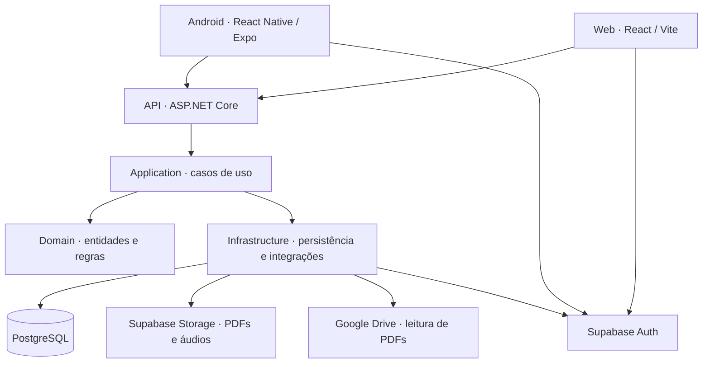
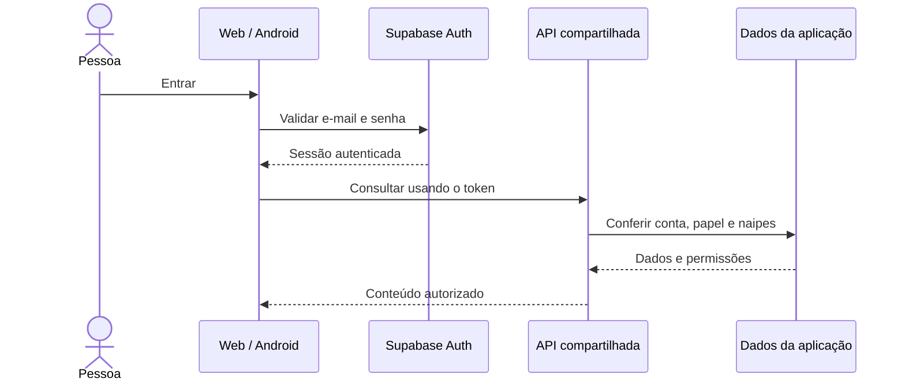
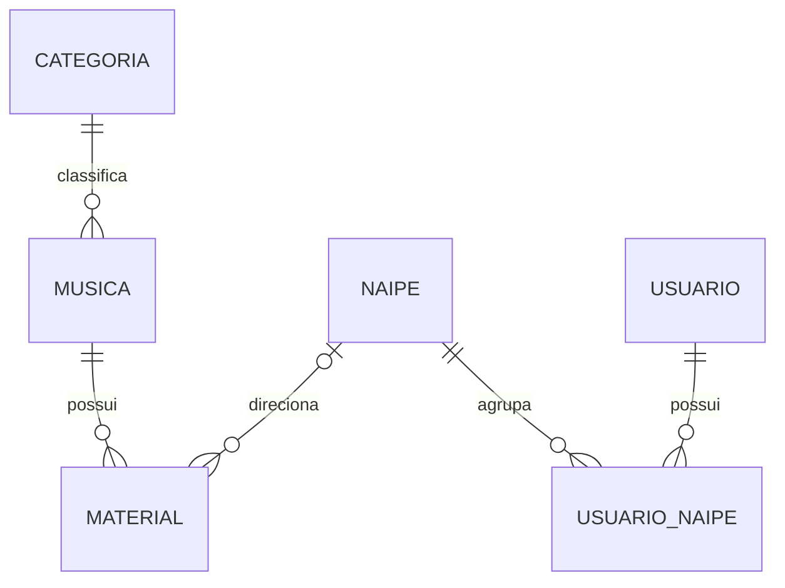

# Arquitetura e decisões técnicas

[Voltar à apresentação](../README.md) · [Funcionalidades](funcionalidades.md)

O Forte Piano utiliza uma API compartilhada por uma aplicação Web e um aplicativo Android. O backend centraliza os dados e as regras de acesso; os clientes adaptam a navegação e os recursos de estudo à plataforma.

## Visão geral

O diagrama representa o fluxo de responsabilidades e integrações, sem expor a configuração do ambiente.

## Backend em camadas

| Camada | Responsabilidade |
|---|---|
| API | Receber requisições, validar autenticação/autorização e expor contratos HTTP |
| Application | Coordenar casos de uso e aplicar as regras da aplicação |
| Domain | Representar usuários, naipes, músicas, categorias e materiais |
| Infrastructure | Implementar acesso ao banco, armazenamento e provedores externos |

A organização é inspirada em Clean Architecture. Interfaces definem os contratos de persistência e integrações utilizados pelos casos de uso, e dependency injection conecta suas implementações na API.

Para o contexto de uma orquestra, uma API em camadas mantém o projeto compreensível e permite atender os dois clientes sem introduzir operação de serviços distribuídos.

## Identidade e autorização

O Supabase Auth cuida da autenticação. A API valida o token e consulta o usuário interno para aplicar papel, situação da conta e vínculos com naipes.

A separação permite bloquear uma conta na aplicação e controlar o acervo sem depender apenas de quais botões a interface exibe. O acesso a materiais considera também a situação da música e os naipes da pessoa.

## Modelo de informações

Uma música reúne seus materiais. Cada material registra seu tipo e origem e pode ter um naipe associado. O vínculo entre pessoas e naipes permite mais de uma participação por usuário, sem reduzir a pessoa a um único instrumento.

O PostgreSQL persiste os dados relacionais com Entity Framework Core e Npgsql. Os arquivos são tratados por serviços de armazenamento, preservando a separação entre metadados e conteúdo binário.

## Arquivos e integração externa

PDFs e áudios enviados ficam no Supabase Storage. O backend fornece acesso temporário aos objetos e verifica permissões para a visualização de partituras. Como uma URL assinada permanece válida até sua expiração, sua validade é parte do modelo de acesso aos arquivos.

PDFs restritos do Google Drive são obtidos pelo backend com uma conta de serviço com acesso de leitura ao acervo. O aplicativo não recebe essa credencial. A integração com Drive apresentada atende à leitura de PDFs.

No Android, o documento é baixado para um cache privado temporário. A leitura usa módulo nativo e preserva o PDF original. O áudio enviado utiliza reprodução nativa, sem gravação de microfone ou serviço de reprodução em segundo plano habilitado nesta versão.

## Reuso entre Web e Android

Os clientes compartilham um conjunto de módulos JavaScript:

- Cliente HTTP autenticado e tratamento de respostas.
- Operações comuns de músicas, pessoas e naipes.
- Opções e políticas de consultas com TanStack Query.
- Utilitários de repertório, materiais e apresentação.
- Fluxo de primeiro acesso e recuperação por código.

Telas, navegação, armazenamento de sessão e componentes de PDF/áudio permanecem próprios de cada plataforma. Cada aplicativo mantém seu cache de consultas e o limpa ao encerrar a sessão.

Essa divisão reaproveita a lógica comum sem obrigar a interface nativa a reproduzir a estrutura HTML/CSS da Web.

## Qualidade e próxima etapa

O projeto de implementação contém testes isolados para partes do frontend, autenticação, cliente HTTP, consultas, navegação e tratamento de materiais, além de lint e builds. Esses recursos verificam comportamentos delimitados; não equivalem à homologação completa das integrações ou do ambiente final.

A próxima etapa técnica é publicar a API/Web, preparar uma distribuição Android independente do computador de desenvolvimento e validar os fluxos com pessoas e materiais autorizados em cenários reais.
